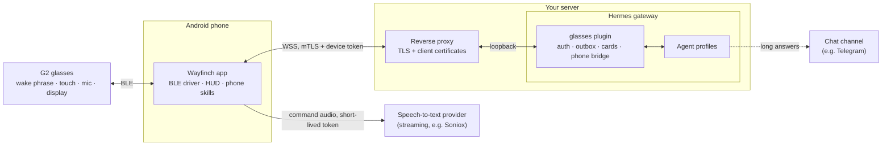

<!-- SPDX-License-Identifier: Apache-2.0 -->
# Wayfinch

Wayfinch turns **Even Realities G2** smart glasses into a voice and heads-up-display front-end for a self-hosted AI
agent built on [Hermes Agent](https://hermes-agent.nousresearch.com/docs), the open-source agent framework. You say
the glasses' built-in wake phrase or press the temple. The phone captures the command, has it transcribed and sends the
text to your own server.
The agent's short answer appears on the glasses a few seconds later. Long answers go to a chat channel your agent
already uses. Two parts make this work: an **Android companion app** that talks to the glasses directly over Bluetooth
LE, and a **Hermes gateway plugin** (`glasses`) that connects the app to your agents over one mutually-authenticated
connection. The app also lets your agents use the phone itself through opt-in **phone skills** (notifications,
messaging, media...), and every action with side effects needs your explicit OK. A later **meeting mode** gives live
hints on the glasses and a written summary afterwards.

> **Status: pre-alpha. Nothing here is usable end to end yet.** The protocol, the plugin's configuration and
> device-registry foundations, and the engineering gates exist and are tested. The Android app, the glasses driver,
> the HUD and the live transport do not exist yet. See [Status](#status).

## How it works



This is the planned design; [Status](#status) lists what exists today.

1. The glasses detect their own wake phrase (or you long-press the temple). The app turns the glasses mic on only
   for that one command (until end of speech, at most 30 s).
2. The app streams the command from the phone directly to a streaming speech-to-text provider (Soniox), using a
   short-lived token that the plugin issues for that one command. The provider key stays on your server. Only the
   final text goes to the plugin, and an agent profile answers. **Fallback:** when streaming speech-to-text is not
   configured or not available, the app sends the recorded clip to the plugin instead, and the gateway transcribes it
   with the speech-to-text provider it already has configured.
3. A short answer travels back over the same connection and is drawn on the glasses. A long one is delivered to
   the owning profile's chat channel, and the glasses show a one-line pointer to it.
4. Results of longer jobs, approval requests and clarifying questions are pushed to the glasses later. They wait in an
   acknowledged outbox while the phone is offline.

Details: [docs/architecture.md](docs/architecture.md). Wire format: [protocol/README.md](protocol/README.md).
Every document: [docs/README.md](docs/README.md).

## Status

What exists **today** on `main` (each item has tests in `make test`; the test Hermes instance itself is started by
hand):

| Area | What is there | Where |
|---|---|---|
| Protocol | Envelope v1 as JSON Schema 2020-12 (27 frame types, UTF-8 byte limits, delivery rules, close codes), golden valid/invalid fixtures and codec edge-case fixtures | [`protocol/`](protocol/) |
| Envelope codec (server side) | Pure-core `decode`/`encode` of envelope v1: frame caps checked before parsing, strict JSON (no repeated keys, no `NaN`/`Infinity`, no lone surrogates), the schema, UTF-8 byte limits, nesting depth and the `seq` direction rules; error frames with a fixed message that never echoes input; helpers that cut text to a UTF-8 byte limit and replace bidi controls in card text. A library only: the caller injects the schema, and nothing calls the codec until the WebSocket server lands | `envelope*.py` |
| Code generation | In-tree, stdlib-only generators: protocol schema → Python `TypedDict`s, and plugin config schema → [configuration reference](docs/reference/config.md); committed output is checked for freshness | [`tools/codegen/`](tools/codegen/), [`hermes-plugin/glasses/generated/`](hermes-plugin/glasses/generated/) |
| Plugin skeleton | Hermes platform registration; an adapter that **fails closed** (reports "not connected", delivers nothing) until the transport lands; refusal of any allow-all / wildcard user setting | [`hermes-plugin/glasses/`](hermes-plugin/glasses/) |
| Plugin config | JSON Schema for the plugin config with precise error messages and a generated [configuration reference](docs/reference/config.md); `config check` CLI (static checks, plus `--live` checks against a Hermes install) | `config.schema.json`, `config*.py`, `admin.py` |
| Device registry | Token stored only as SHA-256, constant-time verification, revocation with tombstones, atomic `0600` writes, fails closed on a corrupt or foreign-owned file | `registry.py` |
| Signer client, `/enroll` relay, admin CLI | A client for the unix socket of the separate device-CA signer (a service built outside this repository, planned; the plugin holds no CA key and the tests use a fake signer): strict request and answer checks, owner and peer-uid checks, one deadline per call. The `/enroll` relay (request checks, rate limit, then the signer's `enrol` op); no HTTP server mounts it yet. The `glasses-admin` commands `config check`, `crl`, `crl --check` and `revoke` ([reference](docs/admin-cli.md)) | `signer_client.py`, `enroll.py`, `admin*.py`, `crl_check.py` |
| Test harness | Scripts for an isolated test instance of a pinned Hermes Agent with a minimal test platform and a mock LLM on loopback ports, never touching a real install ([setup](docs/test-hermes.md)); `make test` checks the scripts against a fake `hermes` | [`tools/test-hermes/`](tools/test-hermes/), [`tools/mock-llm/`](tools/mock-llm/) |
| Quality gates | Secret scan, SPDX headers, size limits, repo hygiene (task ids on `TODO`s, unique glossary terms, no private references), module READMEs, ruff, mypy `--strict` (with a ratchet for modules not typed yet), the Python 3.11 floor, import boundaries, codegen freshness (protocol types and the configuration reference), plugin coverage (core files ≥90 %, other files ≥70 %), hash-pinned installs; docs gates: internal links and anchors resolve and every public document is indexed, a generated [make-target reference](docs/reference/make-targets.md) that must match `mk/*.mk` and the gate table, and a dependency ledger that must list exactly the direct dependencies at their pins | [`mk/`](mk/), [`tools/quality/`](tools/quality/) |

**Planned** (designed, not built): the WebSocket server with device authentication, which will be the codec's first
caller; the outbox;
approval and clarify cards; the voice path; the rest of enrolment and revocation: the HTTP server that mounts `/enroll`,
the signer service itself (built outside this repository), the app's enrolment client, `glasses-admin list` (T1.15f),
the admin-socket server with the live cut that `revoke` asks for (T1.63a), and the plugin's daily `crl --check` run
(schedule it yourself until then:
[CRL has expired](docs/troubleshooting/nginx-crl-expired-rejects-all-devices.md)); the long-answer
router; reverse-proxy examples; and the whole **Android app**: the G2 Bluetooth driver, the HUD, the companion screen,
enrolment, phone skills and the phone bridge. Meeting mode comes later still. Also still to come: CI, the Kotlin
gates, the licence check, the CLI reference and doc tests (see [ENGINEERING.md §10](ENGINEERING.md#10-gates)). The
`android/` directory is an empty placeholder today. The HUD and
the companion screen are designed and mocked up at the real display resolution, but none of that is code yet.

Known limits of the first release, by design: G2 glasses only; Android 17 (API level 37) only; a Hermes gateway and a
TLS reverse proxy with client-certificate support are required.

## Security highlights

Wayfinch's security model is designed and partly implemented. An enrolled device can talk to agents that may hold
powerful tools, so it is treated like a privileged credential:

- **Mutual TLS with per-device certificates.** The app generates its key in the Android Keystore (non-exportable). A
  separate device CA, used for nothing else, signs its certificate. Each device also gets a 256-bit token, which the
  server stores only as a hash. *(Registry and the device CRL commands (`crl` through the signer, `crl --check`):
  built. The device CA and certificate issuance live in a separate signer service (planned); the plugin holds no CA
  key. The revocation command `revoke` (signer `revoke`, then the plugin's admin socket): built; the live cut and the
  admin-socket server: planned (T1.63a). The `/enroll` relay in the plugin: built, mounted by nothing yet (T1.07).
  Enrolment in the app and the signer service: planned.)*
- **Instant revocation.** Revoking a device cuts its live connection within a second, purges its outbox, denies its
  pending approvals and closes its phone-bridge sessions. This is done by the plugin itself, so it does not depend on
  the proxy's CRL support. *(Registry tombstones: built. Live cut: planned.)*
- **Least privilege.** Each device may use only its allow-listed lanes. Approvals from the glasses are limited to
  *allow once* or *deny*. Phone skills are opt-in. Widening phone access needs an on-phone biometric confirmation,
  and side-effect actions need a confirmation that the phone renders itself, so the agent cannot word it.
- **Fail closed.** An unknown state, an expired approval, an unreadable config or an allow-all user setting means
  deny or stop, never allow.
- **No secrets in code or logs.** Every deploy-specific value is configuration with `example.com` examples. Logs carry
  ids and sizes, never tokens, audio or message text. `make test` runs a pinned secret scan over the working tree and
  the history.
- **Pinned, hashed dependencies.** Python dev dependencies install with `pip --require-hashes --only-binary :all:`,
  and the pinned gitleaks binary is verified by SHA-256. Every direct dependency is justified in
  [docs/dependencies.md](docs/dependencies.md).

Reporting a vulnerability: [SECURITY.md](SECURITY.md).

## Engineering standards

The rules are in [ENGINEERING.md](ENGINEERING.md), and the important ones are **enforced by `make test`**, not just
written down:

- **Size and complexity limits:** file ≤400 lines, function ≤60, cyclomatic complexity ≤10, ≤4 parameters, nesting ≤3
  (`tools/quality/check_size.py` + ruff).
- **Lint and format:** ruff, with one pinned configuration for all Python code.
- **Types:** `mypy --strict` over the plugin and the tools, with a ratchet: modules listed in the baseline blocks of
  `mypy.ini` (today one test-only tool, the minimal test platform) are exempt until their cleanup task lands, and new
  modules never get a block. Hermes is not installed in the dev venv, so Hermes imports are untyped (`Any`).
- **Supported Python:** the plugin runs inside the Hermes venv and supports exactly the range Hermes declares in
  `requires-python`, 3.11 to 3.14 (the Hermes commit pinned for the live tests itself needs Python 3.14; an installed
  Hermes may run on 3.11 or newer). The gates hold all Python code to the 3.11 floor: ruff checks 3.11 syntax and mypy
  the 3.11 standard-library APIs (except in modules still under a mypy ratchet block). The dev venv and the test
  suites run on Python 3.14; running the plugin tests under Python 3.11 is planned.
- **Coverage:** plugin tests must cover every core file ≥90 % and every other plugin file ≥70 % (statements and
  branches); a file below its minimum needs an exact ratchet entry.
- **Ports and adapters:** the pure core imports no adapter, framework, Hermes package or I/O module. This is checked
  transitively with import-linter and by an AST purity check that bans builtin I/O and clock reads.
- **Single source of truth:** protocol types and the [configuration reference](docs/reference/config.md) are generated
  from their schemas, the [make-target reference](docs/reference/make-targets.md) from the `#:` lines of the
  `Makefile` and `mk/*.mk`. A stale generated file fails the build.
- **Docs as code:** internal links and anchors must resolve and every public document must be reachable by links from
  this README (the [docs index](docs/README.md) lists them); every `make <target>` a document runs must be a defined
  target or one marked planned in the gate table; the [dependency ledger](docs/dependencies.md) must list exactly the
  direct dependencies at their pinned versions.
- **Hygiene:** every `TODO` carries a task id, the glossary defines each term once, every source file has an SPDX
  header, every module directory has a short README (Purpose, Public API, Invariants), and no file or file name cites
  the private team notes (team-folder paths, decision-record numbers, report names) or carries a review-process tag
  (QA wave or round ids, review/QA/fix round numbers, wave numbers, team-lead lists or decisions, `_qa` file-name
  suffixes); matched in any letter case, exact rule in ENGINEERING.md §9.
  Commit subjects follow a fixed convention, checked by `tools/quality/check_hygiene.py --commits` (run when
  changes are merged; not part of `make test`).
- **Ratchet baselines:** existing violations are listed explicitly, each tagged with the task that removes it. A new or
  grown violation fails, and so does a stale baseline entry.
- **Every gate tests itself:** each gate runs its own tests, including planted violations that must fail.

Solved problems are recorded one per file in [docs/troubleshooting/](docs/troubleshooting/INDEX.md).

## Repository layout

```
android/                Android app (placeholder; planned)
hermes-plugin/glasses/  Hermes gateway platform plugin "glasses" (+ generated protocol types)
hermes-plugin/tests/    plugin tests
protocol/               envelope v1 JSON Schema, specification, fixtures, schema tests
tools/codegen/          generators (protocol schema -> Python types, config schema -> config reference) and their checks
tools/quality/          size, hygiene, module-README, import-purity, mypy-config and coverage checkers, tests, baselines
tools/test-hermes/      isolated, pinned Hermes Agent test instance (harness scripts)
tools/mock-llm/         OpenAI-compatible mock LLM for deterministic integration tests
tools/*.sh              secret scan (pinned gitleaks) and SPDX check
tools/tests/            shell tests of those scripts, the make wiring and the hash-pinned venv install
mk/                     make fragments; each component wires in its own test target
deploy/examples/        example plugin configuration (example.com values)
docs/                   architecture, admin CLI, dependency ledger, glossary, configuration and make-target references,
                        test-instance setup, troubleshooting
ENGINEERING.md          engineering standards
```

## Quick start for contributors

Requirements: git, a POSIX shell, GNU make, **Python 3.14** (every pin has a CPython 3.14 wheel for
Linux x86_64/aarch64 and macOS arm64), and network access the first time (the pinned gitleaks release is downloaded,
checksum-verified and cached under `.local/`; `make test` also keeps pytest's temp files in `.local/pytest-tmp/`).
Python 3.14 is the dev and test toolchain only: the plugin itself
targets Python 3.11–3.14, the range Hermes declares in `requires-python`, and the gates check that all Python code
stays 3.11-compatible.

```sh
make venv        # build .local/venv-dev from requirements-dev.txt (hash-pinned)
                 # if python3 is not 3.14: make venv PYTHON=python3.14
make test        # secret scan + every gate and test suite
make help        # list the top-level targets
```

Each gate also runs on its own, e.g. `make -f mk/protocol.mk test-protocol` or
`make -f mk/typecheck-py.mk typecheck-py`. After editing `protocol/envelope.schema.json`, run
`.local/venv-dev/bin/python tools/codegen/gen_protocol.py`; after editing `hermes-plugin/glasses/config.schema.json`,
run `.local/venv-dev/bin/python tools/codegen/gen_config_docs.py`. Commit the regenerated files. The integration
instance (`make test-hermes-up` / `make test-hermes-down`) needs a pinned Hermes Agent clone and its own Python 3.14
venv, and is not part of `make test`; setup: [docs/test-hermes.md](docs/test-hermes.md).

Contribution rules: [CONTRIBUTING.md](CONTRIBUTING.md). Code of conduct: [CODE_OF_CONDUCT.md](CODE_OF_CONDUCT.md).

## Roadmap

- **Phase 0: feasibility spikes.** Answer the unknowns before building: gateway integration, TLS and Keystore
  behaviour, speech-to-text latency, Android background limits, and glasses behaviour on real hardware.
- **Phase 1: MVP.** Engineering gates first (mostly in place), then the plugin transport, authentication, outbox,
  cards, voice path and admin CLI; the Android app with the G2 driver, HUD, push-to-talk and wake phrase, enrolment
  and the companion screen; and reverse-proxy examples and a quickstart.
- **Phase 2: phone skills.** A phone bridge for the agents (MCP, four stable meta-tools), a skill manifest and a base
  set of skills with phone-rendered confirmations.
- **Phase 3: routing and modules.** A fast front-desk profile that hands longer work to other agent profiles,
  addressable lanes, and optional extra input devices.
- **Phase 4: meeting mode.** Explicitly started streaming transcription with speaker labels, short hints on the
  glasses, and notes and a summary in the chat channel. No audio is stored.
- **Release.** Clean public export, signed APKs with published checksums, and a deployment guide aimed at under an
  hour for someone who already runs Hermes Agent.

## Licence and disclaimer

Licensed under the [Apache License 2.0](LICENSE). See [NOTICE](NOTICE). Exception:
[CODE_OF_CONDUCT.md](CODE_OF_CONDUCT.md) is the Contributor Covenant 2.1 under CC BY 4.0
([THIRD_PARTY_NOTICES.md](THIRD_PARTY_NOTICES.md)).

Wayfinch is an independent open-source project. It is not affiliated with, endorsed by or sponsored by Even Realities,
Mentra or Nous Research (the authors of Hermes Agent). Even Realities, G2 and Hey Even are trademarks or product names
of their respective owners, as are other product names mentioned here. They are used only to describe compatibility.
Using third-party software with your glasses may be against the manufacturer's terms or affect your warranty; you use
it at your own risk. If you use meeting mode, you are responsible for following the recording-consent laws that apply
to you.
