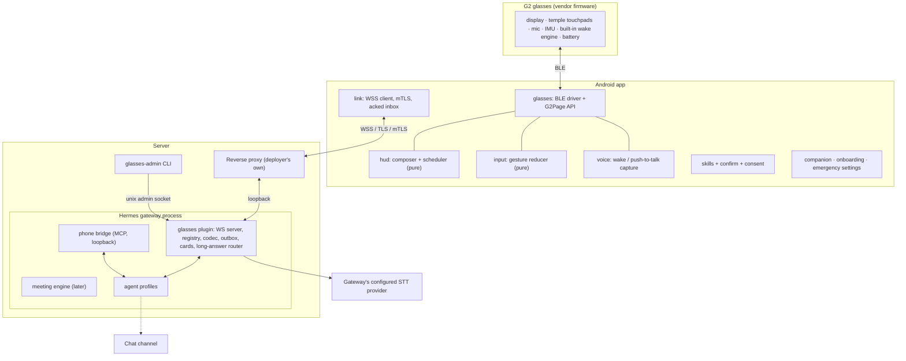
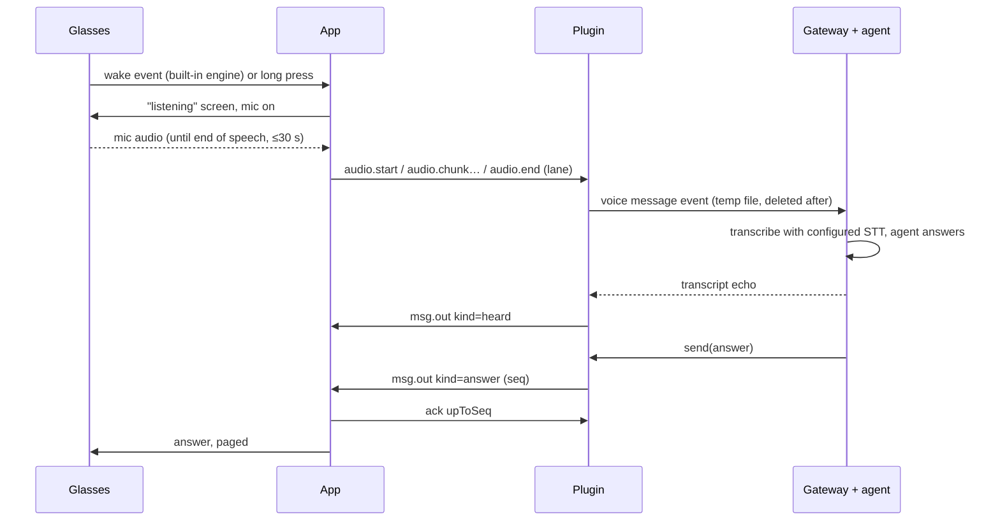

<!-- SPDX-License-Identifier: Apache-2.0 -->
# Architecture

This document describes the target architecture of Wayfinch: what runs where, how data flows, how it is secured, and
why. **Most of it is not built yet.** The README's [Status](../README.md#status) section lists what exists today.
Terms follow [glossary.md](glossary.md). Wire-level details are in [protocol/README.md](../protocol/README.md).

## 1. Components

**Glasses.** The G2 firmware owns the display (576×288, firmware fonts), the touchpads, the microphones, the IMU and a
built-in wake-phrase engine. The glasses have no speaker and no camera. Wayfinch ships no firmware and no vendor assets.

**Android app** (Kotlin, planned). One app with these modules:

| Module | Responsibility |
|---|---|
| `glasses` | The BLE link through a vendored copy of the open-source (Apache-2.0) G2 driver layer from MentraOS, behind our own `G2Page` / settings / mic API. No third-party UI and no analytics code. Connects only to the enrolled glasses |
| `hud` | Pure Kotlin. Fixed layout skeletons, glyph and width budgets, text wrapping and paging, a small animated finch face, and a scheduler that turns screen changes into the fewest display operations within the BLE budget |
| `input` | Pure state machine: gestures from the touchpads → UI actions (idle / listening / answer / card) |
| `voice` | Push-to-talk and the glasses' wake event. The mic is on only from the wake/press until end of speech or 30 s. Opus chunks are sent while capturing |
| `link` | One persistent WSS connection: TLS with a client certificate from the Android Keystore, a per-device token, a pin on the server's CA set, reconnect with backoff, heartbeat, an acked inbox and replay |
| `skills`, `confirm`, `consent` | Phone-skill registry and executor; the single authority for side-effect confirmations; biometric-bound consent for widening access |
| `companion`, `onboarding`, `emergency` | A full-screen companion (the finch face mirroring the state), the setup steps Android forces on-device, and emergency settings behind the device credential |

The phone has no typing UI. Configuration happens by voice or through the agent's chat channel, within the limits in
§4.

**Server.** Everything server-side runs inside the deployer's Hermes gateway. There is no separate service. Built
today: the plugin's platform registration, configuration check (`config check`), device registry and allow-all gate,
the server-side envelope codec (a library no server calls yet), and an adapter skeleton that fails closed (it reports "not connected" and delivers nothing). Everything else in this
table is planned.

| Component | Responsibility |
|---|---|
| Reverse proxy | The deployer's own nginx, Caddy or similar. It terminates TLS, requires and verifies a client certificate against the **device CA only**, forwards the certificate to the plugin in a header (stripping any client-supplied copy), and proxies `/ws` (plus `/enroll` while an enrolment window is open) |
| `glasses` plugin | A Hermes gateway platform plugin. Loopback-only WebSocket server, one connection per device; credentials checked at the HTTP upgrade; device registry; envelope codec; inbound text and voice → gateway message events; `send()` → notice classification → long-answer router → durable outbox with sequence numbers and acks; approval and clarify cards; HUD state; audit log |
| Phone bridge | Planned (Phase 2). An MCP endpoint inside the plugin on a second loopback port. It offers four stable meta-tools (list skills, describe a skill, read, act) and forwards validated calls to the phone over the existing connection |
| `glasses-admin` | Operator CLI. Today it has `config check`. Planned: the device CA, enrolment windows with a QR code, certificate issuance, the CRL, device list, revocation, and server pins |
| Meeting engine | Later (Phase 4). It terminates the meeting audio stream, runs streaming STT with speaker labels, and runs tool-less LLM passes for hints, notes and the summary |

## 2. Data flows

None of these flows is built yet; this section describes the target design.

### 2.1 Voice command → answer on the glasses

Nothing is captured or sent outside this window, except in meeting mode, which the user starts explicitly. Answer
latency depends mainly on the deployer's STT provider and model.

### 2.2 Long answers → chat channel

When a reply is longer than a configurable threshold (default 280 characters, never more than 2048 UTF-8 bytes), or
contains a table, code, several links or an attachment, the plugin does two things. It sends the glasses at once a
one-line pointer with the first sentence (≤512 B) and a phone-side copy (≤4096 B). Its outbox worker then delivers the
**complete** text asynchronously to the home channel of the profile that owns the lane (default platform: Telegram).
Delivery status (`sent` / `retrying` / `failed`) follows as `long.status`. A permanent failure leaves the answer saved
on the phone. The agent needs no tool for this: the plugin is the only mechanism.

### 2.3 Slow work and later pushes

A fast front-desk profile answers short questions itself. Longer jobs go to other profiles through the agent
framework's own task hand-off. The glasses show a short "handed off" acknowledgement. Later results, blocked tasks
and notices arrive through `send()`, are classified (agent reply, task notice, system notice, transcript echo) and
pushed as `msg.out`. While the phone is offline they wait in the outbox (TTL 24 h, at most 500 per device) and are
replayed after `hello.lastAckedSeq` on reconnect.

### 2.4 Approvals and clarifying questions

The plugin overrides the gateway's approval and clarify prompts:

- **Exec approvals** become `approval.request` cards. The only choices are `once` or `deny`, *deny* is preselected,
  confirming takes two steps, and expiry fails closed. Card text is cut on code-point boundaries, and bidi control
  characters are rejected so the text cannot be visually reordered.
- **Clarifying questions** never expire. If the agent moves on, the card stays as a *detached* question, and answering
  it later starts a new turn. Only an explicit dismissal or a revocation removes it.

### 2.5 Phone skills (Phase 2)

An agent calls the bridge's meta-tools. The bridge validates the arguments against the device's skill manifest and
sends `skill.call`. The phone validates again, checks that the skill is enabled and its permission granted, and, if
the skill has side effects, renders the exact action from its own template on the glasses and as a phone
notification. A single-use nonce, bound to the call and an argument hash, must be confirmed within 120 s. Rejections
and timeouts return `denied` / `expired`. A write that times out is reported as uncertain and never retried.

### 2.6 Meeting mode (Phase 4)

Meeting mode starts only by an explicit user action and only on devices with the `meeting` feature. The glasses show a
reminder to announce it, and the phone shows a persistent "recording" notification. Glasses-mic audio streams over the
existing connection to the plugin, which relays it to a streaming STT provider with speaker labels. The provider key
stays on the server and never reaches the phone. Tool-less LLM passes turn the rolling transcript into short hints
(one at a time on the glasses), periodic notes, and a final summary and transcript delivered to the chat channel.
**No audio is stored anywhere.** Transcript text is kept on the server for a limited, configurable time. Meeting
participants are untrusted input: their speech never reaches an agent session that has tools.

## 3. Protocol overview

The app (device, D) and the plugin (server, S) exchange JSON *envelopes* over one WebSocket. The single source of truth
is [`protocol/envelope.schema.json`](../protocol/envelope.schema.json) (JSON Schema 2020-12). Its rules are documented
in [`protocol/README.md`](../protocol/README.md). Python types are generated from it today; Kotlin types will be
generated from it with the Android app. The server-side codec that enforces these rules on every frame it
decodes or encodes is built (`hermes-plugin/glasses/envelope*.py`); the WebSocket server that will call it, the
outbox, the dedupe by `id` and the Android codec are planned.

- **Envelope:** `v`, `id` (ULID), `type`, `ts`, optional `seq`, `corr`, `lane`, and a strict `body` (no extra fields;
  every field bounded).
- **27 frame types:** session (`hello`, `welcome`, `ping`, `pong`, `ack`, `error`), messages (`msg.in`, `msg.out`,
  `long.status`), voice (`audio.*`), cards (`approval.*`, `clarify.*`, `card.state`), HUD state (`hud.state`), phone
  skills (`skill.*`) and meeting mode (`meeting.*`).
- **Delivery:** server-to-device frames carry a per-device `seq` and stay in the outbox until acked. Device-to-server
  frames are deduplicated by `id`. Keep-alives are never queued.
- **Limits:** frame caps are checked before parsing (64 KiB; 32 KiB for audio). String limits are **UTF-8 byte**
  limits. A test proves that every schema-valid frame fits its cap even with worst-case escaping.
- **Close codes:** `4400` unsupported version, `4401` unauthorised, `4403` revoked, `4409` replaced by a newer
  connection. Authentication failures before the upgrade are plain HTTP `401`/`403`.

## 4. Security model

An enrolled device can ask agents that may have powerful tools to act, so **a device credential is treated as
privileged**. Every control below follows from that.

This section is the target design. Built today: device tokens stored only as SHA-256 hashes and verified in constant
time, revocation tombstones in the registry, a registry that fails closed on a corrupt or foreign-owned file, refusal
of allow-all or wildcard user settings, a `host` setting that accepts loopback addresses only, and the pinned secret
scan in `make test`. Everything else here (the transport and its authentication, mTLS, enrolment, live revocation, the
phone bridge, the app's controls, CI and release signing) is planned.

| Boundary | Controls |
|---|---|
| Glasses ⇄ phone (BLE) | Connect only to the enrolled glasses; the mic is off unless listening, with a visible indicator; secrets are never drawn on the display |
| App ⇄ other apps | No exported components beyond the launcher, immutable notification intents and the foreground service; no local servers; settings behind the device credential |
| Third-party code in the app | Vendored driver reviewed at a pinned commit and on every sync; dependencies pinned with checksums (Gradle dependency verification); no analytics code, enforced by a guard and an egress test; licence check |
| Phone ⇄ proxy (internet) | TLS with mTLS against a dedicated device CA; client key non-exportable in the Keystore; server trust = system anchors + a CA-set pin (Certificate Transparency stays on); rate limits; only `/ws` exposed, plus `/enroll` during an enrolment window |
| Proxy ⇄ plugin (loopback) | The plugin binds `127.0.0.1` only; it checks the bearer token (constant-time, on SHA-256) **and** that the forwarded certificate's fingerprint matches the registry |
| Plugin ⇄ agents | Lanes allow-listed per device; glasses approvals limited to once/deny; inbound text treated as user input; skill outputs wrapped as data, never instructions |
| Agents ⇄ phone bridge | Loopback bind and a separate bearer secret; configured only in the profiles the deployer lists |
| Chat channel ⇄ agents | Requests from chat can only **narrow** phone access; **widening** needs a biometric-bound consent signature made on the phone |

**Enrolment.** `glasses-admin` opens a short enrolment window and shows a QR code (URL, one-time code, server pins). The
app generates its key in the Android Keystore and sends the public key with a proof-of-possession signature. The CLI
issues a short-lived certificate from the device CA and a 256-bit token. The code is single-use, and the window closes
after use. Certificates are renewed over the authenticated channel.

**Revocation is immediate and does not depend on the proxy.** `glasses-admin revoke` writes the registry and calls the
running plugin over a unix-domain admin socket (mode `0600`). The plugin then kills the token, keeps the fingerprint
only as a tombstone, closes the connection with `4403` within one second, purges the outbox, drops unhandled inbound
frames and in-flight voice, denies pending approvals, cancels clarify cards, closes phone-bridge sessions and stops a
running meeting. A file-change backstop applies a revocation even if the socket was unreachable. A regenerated CRL for
the proxy is optional extra hardening.

**Secrets and logs.** Nothing secret is in git (`make test` runs a pinned gitleaks scan). Tokens are stored only as
hashes, the CA key is `0600`, and provider keys live in the agent's environment file. Logs and audit entries carry ids,
counts and sizes, never tokens, certificates, audio, transcripts or message text.

**Fail closed.** An unknown state, an expired approval, an unreadable or corrupt config/registry, a wildcard or
allow-all user setting, or a non-loopback bind is refused.

**Supply chain and CI (planned for the public repo).** CI runs on `pull_request` only, with read-only permissions and no
repository secrets, and actions are pinned by SHA. Release APKs are signed offline by the maintainer and published
with checksums and the signing-certificate fingerprint.

## 5. Key design decisions

| Decision | Why | Rejected |
|---|---|---|
| Own Android app on direct BLE, no vendor phone app or cloud in the data path | Full control of the UI and the data path | Vendor plugin ecosystems (need the vendor app and cloud) |
| Vendored, Apache-2.0 G2 driver layer behind our own API | Stable API, no third-party UI or analytics, upstream fixes still reachable by diff | Shipping a full SDK with its UI and analytics; writing our own driver from scratch |
| Hermes **gateway platform plugin** | The only interface that has push, approvals, clarify, scheduled/hand-off delivery and profile routing in one place | The agent's HTTP API (no push, no clarify, unattended approvals) |
| Phone bridge as MCP with four stable meta-tools inside the plugin | One phone socket and one auth system; a fixed tool list (no schema churn per skill) | One MCP tool per skill; a separate bridge process |
| Built-in G2 wake phrase; push-to-talk always available | No phone-side wake engine, licence or model; no always-on phone mic | Phone-side keyword spotting |
| Command STT through the gateway's **existing** STT path (voice message events) | No new STT service, port or key; deployers keep whatever provider they already use | A dedicated STT service; on-phone STT |
| Persistent WSS with an acked outbox; no push service in v1 | No third-party cloud or server key in the trust path | Push-notification wake-ups (possible later) |
| Long answers to the owning profile's chat channel, routed by the plugin | The glasses show short text only; the chat is an existing reading surface | Paging long text on the glasses |
| Phone-rendered, nonce-bound confirmations | The agent cannot word or forge what the user approves | Relying only on the agent framework's approval policy |
| Ports and adapters with a pure core; enforced import boundaries | Deterministic, fast tests; adapters stay thin | Business rules inside socket handlers |
| Schema-driven codegen from one JSON Schema | One contract for both stacks; drift fails the build | Hand-written types; generic generators that cannot express the body dispatch |
| Fail-closed defaults everywhere | A misconfiguration must never grant access | Permissive defaults with warnings |
| Deployer's own reverse proxy; no proxy-less mode | TLS and client-cert handling stay in proven software; the plugin stays loopback-only | Exposing the plugin directly |
| Config-driven deployment, no host-specific values in code | Others can deploy it; examples use `example.com` | A single-operator runbook |
| Meeting stream terminates on the server; no audio stored | Provider keys stay server-side; minimal retention | Phone → provider directly with long-lived keys |
| English UI from message catalogs | Translatable without code changes; budgets tested per locale | Hard-coded strings |

## 6. Deliberately out of scope

- Glasses other than the G2, and phones other than Android. v1 targets Android 17 (API level 37) only.
- Any server component outside the Hermes gateway: no docker-compose stack, no separate STT service, no proxy-less
  mode.
- Agent logic in the app. The agents stay the brain; the app is a front-end and a set of phone capabilities.
- A typing UI or a general settings app on the phone.
- Continuous listening outside a command or an explicitly started meeting. Wayfinch never stores meeting audio.
- Phone-side wake-word engines.
- Reverse engineering of the glasses protocol by this project, and bundling any vendor firmware, fonts or logos.
- Distribution through app stores in v1: source and signed APKs only.
