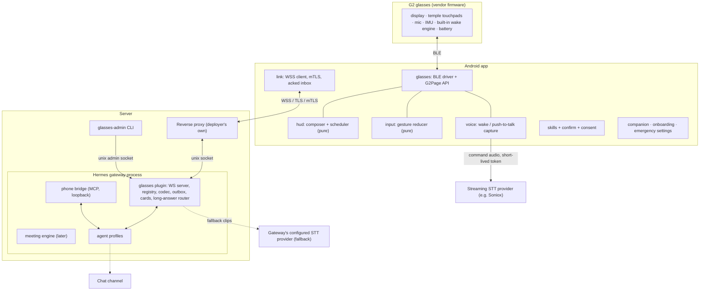
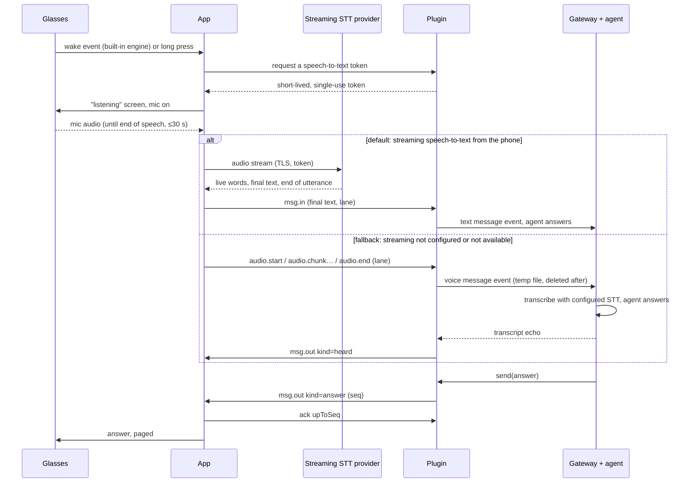

<!-- SPDX-License-Identifier: Apache-2.0 -->
# Architecture

This document describes the target architecture of Wayfinch: what runs where, how data flows, how it is secured, and
why. **Most of it is not built yet.** The README's [Status](../README.md#status) section lists what exists today.
Terms follow [glossary.md](glossary.md). Wire-level details are in [protocol/README.md](../protocol/README.md).

## 1. Components

**Glasses.** The G2 firmware owns the display (576×288, firmware fonts), the touchpads, the microphones, the IMU and a
built-in wake-phrase engine. The glasses have no speaker and no camera. Wayfinch ships no firmware and no vendor assets.

**Android app** (Kotlin, planned). One app with these modules:

| Module | Responsibility |
|---|---|
| `glasses` | The BLE link through a vendored copy of the open-source (Apache-2.0) G2 driver layer from MentraOS, behind our own `G2Page` / settings / mic API. No third-party UI and no analytics code. Connects only to the enrolled glasses |
| `hud` | Pure Kotlin. Fixed layout skeletons, glyph and width budgets, text wrapping and paging, a small animated finch face, and a scheduler that turns screen changes into the fewest display operations within the BLE budget |
| `input` | Pure state machine: gestures from the touchpads → UI actions (idle / listening / answer / card) |
| `voice` | Push-to-talk and the glasses' wake event. The mic is on only from the wake/press until end of speech or 30 s. The audio streams from the phone directly to the streaming STT provider with a short-lived token from the plugin, and only the final text goes to the plugin. Fallback, when streaming STT is not configured or not available: the clip goes to the plugin as Opus chunks while capturing |
| `link` | One persistent WSS connection: TLS with a client certificate from the Android Keystore, a per-device token, a pin on the server's CA set, reconnect with backoff, heartbeat, an acked inbox and replay |
| `skills`, `confirm`, `consent` | Phone-skill registry and executor; the single authority for side-effect confirmations; biometric-bound consent for widening access |
| `companion`, `onboarding`, `emergency` | A full-screen companion (the finch face mirroring the state), the setup steps Android forces on-device, and emergency settings behind the device credential |

The phone has no typing UI. Configuration happens by voice or through the agent's chat channel, within the limits in §4.

**Server.** Everything server-side runs inside the deployer's Hermes gateway; the only separate service is the device-CA
signer (planned, built outside this repository). Built today: the plugin's platform registration, configuration check (`config check`), the device CRL commands (`crl` asks
the device-CA signer to generate and publish it, `crl --check`; the plugin holds no CA key), `revoke` (the signer's
tombstone and CRL, then the plugin's admin socket), the signer client, the `/enroll` relay (mounted on the WebSocket server's HTTP app, which
is served on the edge's unix socket only), device registry and allow-all gate, the read-only reader of the signer's published registry with the plugin's
deny overlay and last-seen file (`registry_signer_file.py`; wired by the adapter's `connect()`),
the server-side envelope codec and the WebSocket session that calls it (`server_session.py`, run by `server.py`), the edge listener on the unix socket `edge.socket` with the check of the forwarded client certificate (`edge_listener.py`, `edge_auth.py`, `edge_cert.py`), and an adapter that fails closed (`connect()` starts the listener only while the allow-all gate is closed and the edge settings are usable, otherwise it reports "not connected" and retries; a `msg.in` on an allowed lane becomes a gateway text event with the authenticated device's id as `user_id`, which the gateway checks against `GLASSES_ALLOWED_USERS` (`inbound.py`, in-memory dedupe by `id`; any other frame type is not dispatched yet) and `send()` stores one `msg.out` per recipient (every non-revoked registry device holding the lane) in the outbox, writes it to a welcomed connection and replays it on the next `hello` until acked (`outbox.py`, `outbound.py`, T1.09b). Everything else in this table is planned.

| Component | Responsibility |
|---|---|
| Reverse proxy | The deployer's own nginx, Caddy or similar. It terminates TLS, requires on `/ws` a client certificate and verifies it against the **device CA only**, forwards the certificate to the plugin in a header (stripping any client-supplied copy), and proxies `/ws` and `/enroll` (always routed: the signer refuses an enrolment while no window is open) |
| `glasses` plugin | A Hermes gateway platform plugin. WebSocket server on the edge's unix socket only (no TCP listener), one connection per device; credentials checked at the HTTP upgrade; device registry; envelope codec; short-lived speech-to-text tokens minted per command or meeting session (the long-lived provider key stays here); inbound text (incl. the final text of a command) and fallback voice clips → gateway message events; `send()` → notice classification → long-answer router → durable outbox with sequence numbers and acks; approval and clarify cards; HUD state; audit log |
| Phone bridge | Planned (Phase 2). An MCP endpoint inside the plugin on a second loopback port. It offers four stable meta-tools (list skills, describe a skill, read, act) and forwards validated calls to the phone over the existing connection |
| `glasses-admin` | Operator CLI. Today it has `config check` (`--live` also checks the host and the routed Hermes profiles; it writes nothing into the Hermes home, reads `<home>/.env` (a regular file of at most 1 MiB, never rewritten; names that load code or move directories, such as `PATH`, `LD_*` or the plugin switches, are not taken from it, and the plugin discovery never sees it) for the `${VAR}` refs, `HERMES_LOCAL_STT_LANGUAGE` and the `allow_all_users` grant of `config.yaml` (top level or under `gateway:`) the gateway would see, prints no `.env` value of four characters or more and no value that a `${VAR}` puts into a timeout or into the whole name of a routed profile (a shorter `.env` value, or a process-environment value, inside a longer profile name can still be printed, and so can a `.env` value padded with white space inside quotes, `NAME=" value "`, when it is used as a whole route profile name: Hermes strips and lower-cases that name, the mask and the hiding compare the raw value, so it is printed in its stripped, lower-cased form; tool names outside Hermes' toolset table are only counted, profile names must be plain identifiers, Hermes' own log output is silent), and refuses, exit 2, a home the effective user does not own; plugins installed under a profile's own home are not discovered by this check, so tool parity is computed from the config only) and `crl` / `crl --check` (`crl` asks the device-CA signer over `signer.socket` to generate and publish the device CRL and prints one line per CA; a signer that is down, slow or refuses is one fixed error line and exit 1; the plugin holds no CA key and never signs; `crl --check` checks the CA and CRL bundles the signer publishes in `signer.public_dir`: it warns 14 days before a CRL and 180 days before a CA expires, exits 1 on errors and 3 on warnings only, and never reads the edge copy) and `revoke DEVICE_ID` (asks the signer's `revoke` op for the tombstone and the CRL, then the running plugin over `$state_dir/admin.sock`; exit 0 only when both confirm; the admin-socket server and the live cut are planned, T1.63a). The signer itself (device CA, issuance) is a separate service, planned; enrolment windows are opened only from the root side, never by this CLI. Planned: device list (T1.15f), the live cut (T1.63a), the plugin's daily `crl --check`, and server pins. Command reference: [admin-cli.md](admin-cli.md) |
| Meeting engine | Later (Phase 4). It mints a short-lived provider token per meeting session (the phone streams the audio to the streaming STT provider directly, with speaker labels), receives the transcript text from the phone, and runs tool-less LLM passes for hints, notes and the summary. It never receives meeting audio |

## 2. Data flows

None of these flows is built yet; this section describes the target design.

### 2.1 Voice command → answer on the glasses

Nothing is captured or sent outside this window, except in meeting mode, which the user starts explicitly.

By default the command audio goes from the phone straight to the streaming STT provider over TLS, and only the final
text reaches the server. The phone holds only a short-lived, single-use token that the plugin mints for this one
command, and only for a registered, non-revoked device. The long-lived provider key stays on the server. The token
frames are planned additions to the protocol (§3). The **fallback** clip path through the plugin and the gateway's
configured STT provider is used only when streaming STT is not configured on the server or not available (token
refused, provider unreachable, stream failed, daily usage cap reached). A revoked device gets no token and sends no
fallback clip. On the fallback path, answer latency depends mainly on the deployer's STT provider and model.

### 2.2 Long answers → chat channel

When a reply is longer than a configurable threshold (default 280 characters, never more than 2048 UTF-8 bytes), or
contains a table, code, several links or an attachment, the plugin does two things. It sends the glasses at once a
one-line pointer with the first sentence (≤512 B) and a phone-side copy (≤4096 B). Its outbox worker then delivers the
**complete** text asynchronously to the home channel of the profile that owns the lane (default platform: Telegram).
Delivery status (`sent` / `retrying` / `failed`) follows as `long.status`. A permanent failure leaves the answer saved
on the phone. The agent needs no tool for this: the plugin is the only mechanism. Built today (T1.09b): the outbox and
the send path; a reply over 2048 B is cut to 2045 B plus `…` until this long-reply router (planned, T1.41) replaces
the cut.

### 2.3 Slow work and later pushes

A fast front-desk profile answers short questions itself. Longer jobs go to other profiles through the agent
framework's own task hand-off. The glasses show a short "handed off" acknowledgement. Later results, blocked tasks
and notices arrive through `send()`, are classified (agent reply, task notice, system notice, transcript echo) and
pushed as `msg.out`. While the phone is offline they wait in the outbox (TTL 24 h, at most 500 per device) and are
replayed after `hello.lastAckedSeq` on reconnect.

### 2.4 Approvals and clarifying questions

The plugin overrides the gateway's approval and clarify prompts:

- **Exec approvals** become `approval.request` cards. The only choices are `once` or `deny`, *deny* is preselected,
  confirming takes two steps, and expiry fails closed. Card text is cut on code-point boundaries, and bidi control
  characters are rejected so the text cannot be visually reordered.
- **Clarifying questions** never expire. If the agent moves on, the card stays as a *detached* question, and answering
  it later starts a new turn. Only an explicit dismissal or a revocation removes it.

### 2.5 Phone skills (Phase 2)

An agent calls the bridge's meta-tools. The bridge validates the arguments against the device's skill manifest and
sends `skill.call`. The phone validates again, checks that the skill is enabled and its permission granted, and, if
the skill has side effects, renders the exact action from its own template on the glasses and as a phone
notification. A single-use nonce, bound to the call and an argument hash, must be confirmed within 120 s. Rejections
and timeouts return `denied` / `expired`. A write that times out is reported as uncertain and never retried.

### 2.6 Meeting mode (Phase 4)

Meeting mode starts only by an explicit user action and only on devices with the `meeting` feature. The glasses show a
reminder to announce it, and the phone shows a persistent "recording" notification. Glasses-mic audio streams from the
phone directly to a streaming STT provider with speaker labels, using a short-lived token that the plugin mints for
that meeting session. The long-lived provider key stays on the server and never reaches the phone. The phone sends
the transcript text to the plugin, and the server never receives meeting audio. Tool-less LLM passes turn the rolling
transcript into short hints
(one at a time on the glasses), periodic notes, and a final summary and transcript delivered to the chat channel.
**No audio is stored anywhere.** Transcript text is kept on the server for a limited, configurable time. Meeting
participants are untrusted input: their speech never reaches an agent session that has tools.

## 3. Protocol overview

The app (device, D) and the plugin (server, S) exchange JSON *envelopes* over one WebSocket. The single source of truth
is [`protocol/envelope.schema.json`](../protocol/envelope.schema.json) (JSON Schema 2020-12). Its rules are documented
in [`protocol/README.md`](../protocol/README.md). Python and Kotlin types are generated from it (`tools/codegen/`; the
Kotlin envelope types are in the `:protocol` module). The server-side codec that enforces these rules on every frame it
decodes or encodes is built (`hermes-plugin/glasses/envelope*.py`); the WebSocket session that calls it on every frame is
built too (`server.py`, `server_session.py`, `server_auth.py`, `connections.py`; served on the edge's unix socket by `edge_listener.py`); the dedupe by `id`
is built for `msg.in` (in memory, `inbound.py`, T1.08; durable dedupe planned, T1.168); the outbox is built (`outbox.py`,
T1.09b); the Android codec is planned.

- **Envelope:** `v`, `id` (ULID), `type`, `ts`, optional `seq`, `corr`, `lane`, and a strict `body` (no extra fields;
  every field bounded).
- **27 frame types:** session (`hello`, `welcome`, `ping`, `pong`, `ack`, `error`), messages (`msg.in`, `msg.out`,
  `long.status`), voice (`audio.*`: the fallback clip path; the frames that hand the phone a speech-to-text token
  are planned), cards (`approval.*`, `clarify.*`, `card.state`), HUD state (`hud.state`), phone
  skills (`skill.*`) and meeting mode (`meeting.*`).
- **Delivery:** server-to-device frames carry a per-device `seq` and stay in the outbox until acked. Device-to-server
  frames are deduplicated by `id`. Keep-alives are never queued.
- **Limits:** frame caps are checked before parsing (64 KiB; 32 KiB for audio). String limits are **UTF-8 byte**
  limits. A test proves that every schema-valid frame fits its cap even with worst-case escaping.
- **Close codes:** `4400` unsupported version, `4401` unauthorised, `4403` revoked, `4409` replaced by a newer
  connection. Authentication failures before the upgrade are plain HTTP `401`/`403`.

## 4. Security model

An enrolled device can ask agents that may have powerful tools to act, so **a device credential is treated as
privileged**. Every control below follows from that.

This section is the target design. Built today: device tokens stored only as SHA-256 hashes and verified in constant
time, revocation tombstones in the registry, a registry that fails closed on a corrupt or foreign-owned file, refusal
of allow-all or wildcard user settings, validated `edge.socket` (an absolute path, at most 107 bytes, no `..`) and `edge.user` (a system user name, never `root`) settings, the client of the
device-CA signer's socket (owner and peer-uid checks, no CA key in the plugin), the plugin's side of enrolment (the
`/enroll` relay: request checks and a rate limit, then the signer's `enrol` op; mounted by `server.py`), the WebSocket session (`server_session.py`: hello/welcome, frame loop) and the authentication of its upgrade
(`server.py`, `server_auth.py`: token and verified certificate fingerprint, registry and revocation answers), the check of the forwarded client certificate (`edge_cert.py`: verified against the signer's `device-ca.pem`; the device identity is the SHA-256 of that certificate, a forwarded fingerprint header is never read), the edge listener (`edge_listener.py`, `edge_auth.py`: `/ws` and `/enroll` served only
on the unix socket `edge.socket`, mode 0660, no TCP listener; a path that is not a stale socket of the plugin's user is
left untouched and the listener does not start; every connection whose `SO_PEERCRED` uid is not `edge.user`'s, or
whose credentials cannot be read, is closed before a byte of it is read, and the same check guards each request), the reader of the signer-published `devices.json` (`registry_signer_file.py`: the directory opened once, refused when it is a symlink, owned by the plugin user or writable by group or others, then a regular file in it owned by the signer user, mode 0640 or stricter, read-only, no cached copy, any other state is an error and no device authenticates; a symlink is refused for the last path component only, the parents of `signer.public_dir` are the operator's job: root- or signer-owned, not writable by the plugin user; the plugin's own deny overlay `revoked-local.json` and `last-seen.json` beside it, the overlay a convenience copy held by the plugin's own user: a process with that uid can drop an entry (effective at the next gateway restart) or add one (that phone is told it was revoked and wipes itself), real revocations go through the signer, whose tombstone that user cannot edit (removing an id from `revoked-local.json` does not bring a purged device back: its outbox purge is permanent and it gets no outbox rows again, a revoked id is never reused); the live cut and the alert when the file turns bad are T1.63a), the
signer-then-admin-socket client of `glasses-admin revoke`, and the pinned secret
scan in `make test`. Everything else here (the signer service itself, mTLS verification of the
enrolment window and the app's enrolment, the plugin's side of the admin socket and the live cut, the phone bridge, the
app's controls, CI and release signing) is planned.

| Boundary | Controls |
|---|---|
| Glasses ⇄ phone (BLE) | Connect only to the enrolled glasses; the mic is off unless listening, with a visible indicator; secrets are never drawn on the display |
| App ⇄ other apps | No exported components beyond the launcher, immutable notification intents and the foreground service; no local servers; settings behind the device credential |
| Third-party code in the app | Vendored driver reviewed at a pinned commit and on every sync; dependencies pinned with checksums (Gradle dependency verification); no analytics code, enforced by a guard and an egress test; licence check |
| Phone ⇄ proxy (internet) | TLS, with mTLS against a dedicated device CA on `/ws` (`/enroll` cannot require one: the device has none yet); client key non-exportable in the Keystore; server trust = system anchors + a CA-set pin (Certificate Transparency stays on); rate limits; only `/ws` and `/enroll` exposed (`/enroll` always routed and rate-limited; without an open enrolment window the signer refuses it) |
| Phone ⇄ streaming STT provider (internet) | TLS to the provider's host only, while a command capture or a meeting is open; the phone holds only short-lived, single-use, scope-limited tokens in memory (never stored or logged), minted by the plugin per command or meeting session and only for non-revoked devices; the long-lived provider key never leaves the server; the provider sees the phone's IP address |
| Proxy ⇄ plugin (unix socket) | The plugin serves `/ws` and `/enroll` only on the unix socket `edge.socket` (mode 0660; no TCP listener) and admits a connection only when its `SO_PEERCRED` uid is the uid of `edge.user` (any other peer is closed before a byte is read, so the forwarded certificate header counts only from the edge); it verifies the forwarded client certificate against the signer's device CA bundle (signature, validity, `CA:false`, key usage, clientAuth, no critical extension it does not process, EC key and SHA-2 strength) and checks the bearer token (constant-time, on SHA-256) **and** that the verified certificate's fingerprint matches the registry; the edge must set the certificate header from the TLS handshake (proof of possession happens there) |
| Plugin ⇄ agents | Lanes allow-listed per device; glasses approvals limited to once/deny; inbound text treated as user input, never as a gateway command or an answer to a pending approval or clarify prompt (the plugin's text events carry `allow_gateway_control=False`, built); skill outputs wrapped as data, never instructions |
| Agents ⇄ phone bridge | Loopback bind and a separate bearer secret; configured only in the profiles the deployer lists |
| Chat channel ⇄ agents | Requests from chat can only **narrow** phone access; **widening** needs a biometric-bound consent signature made on the phone |

**Enrolment (planned, not running yet).** The device CA key and certificate issuance live in a separate signer service
under its own user, built and reviewed outside this repository; the plugin
holds no CA key and asks the signer over its unix socket. Only the root side opens an enrolment window: the operator
from a root-side confirmation card on his phone, a root-side administrator at his request, or the signer's root CLI - never
`glasses-admin`, the plugin or an agent. The window's payload (URL, one-time code, server pins) goes to the operator as
an app link or QR text (the app reads the link, a pasted link or the pasted JSON with one strict parser, built in
`:protocol`, T1.23a; its enrolment screen and client, T1.23b, are planned). The app generates its key in the Android Keystore and sends the public key with a
proof-of-possession signature to `/enroll`; the plugin relays it to the signer (`enroll.py`, built: request checks, rate
limit, then the signer's `enrol` op; mounted for every method by `server.py`, T1.07c, and served on the edge's unix socket). The signer issues a
short-lived certificate and a 256-bit token only after the operator confirms the key fingerprint on a root-side card;
the code is single-use, and the window closes after use. Certificates are renewed over the authenticated channel.

**Revocation is immediate and does not depend on the proxy.** `glasses-admin revoke DEVICE_ID` (built, T1.15e) first
asks the signer's `revoke` op to write the tombstone and the new CRL (the CLI writes no file itself), then calls the
running plugin over the unix-domain admin socket `$state_dir/admin.sock` (one JSON line each way,
`glasses.admin_protocol`; the client refuses a path that is not a socket owned by its own user or a peer of another
uid). It exits 0 only when both confirm; any signer failure, `unknown_device` included, still calls the socket (the cut
only narrows access) and then exits 1. A config with errors stops `revoke` before both steps (neither the signer nor
the plugin is asked): fix the config first (`glasses-admin config check`), or the open session stays until a gateway
restart. The socket server and the live cut below are planned (T1.63a): the plugin then kills the token, keeps the fingerprint
only as a tombstone, closes the connection with `4403` within one second, purges the outbox, drops unhandled inbound
frames and in-flight voice, denies pending approvals, cancels clarify cards, closes phone-bridge sessions, stops
minting speech-to-text tokens and stops a running meeting. The revocation signal is close `4403` or a marked `403`
(`RevocationMarker`, `:protocol`, T1.24d: media type `application/json`, at most `charset=utf-8`, a body of at most
1 024 bytes, read through a cap, whose strict JSON object has `error` = `device_revoked`); any other `403` is "access
denied" and wipes nothing. The phone side of the signal is planned (T1.24a/b wire it; only the `:core` class exists,
T1.24c): on the revocation signal the link will run the ordered, fail-safe `RevocationSequence` (steps 0 to 6; every
hook is guarded, a step-0 hook stores the revoked flag and the sequence reports step 0 as failed when the flag is not
set afterwards, so that an app killed in between re-runs it at the next start) and will close any open provider
stream, wipe its tokens and send no fallback clip. Until then, a revocation the signer confirmed refuses new
connections (tombstone and CRL); an already open session, idle or not, is closed with `4403` within about a second
(the plugin polls the stat of the signer's `devices.json` every 0.5 s and re-reads it when it changes, T1.248) and gets
no queued answer replayed, so the signer's revocations need no restart; a revocation only in the plugin's deny overlay
still waits for the plugin's live cut (planned, T1.63a / T1.179) or a gateway restart; `revoke` says so when the socket
leg is not confirmed. That poll is the file-change backstop for the signer's revocations even when the socket was
unreachable; the rest of the live cut (token kill, the alert on a bad file, the other hooks) is planned (T1.63a /
T1.179). A regenerated CRL for the proxy
is optional extra hardening.

**Secrets and logs.** Nothing secret is in git (`make test` runs a pinned gitleaks scan). Tokens are stored only as
hashes, the plugin holds no CA key (it stays with the separate signer service under its own user; planned), and
long-lived provider keys stay on the server in the gateway's environment (supplied
from a secret manager, not a plaintext file) and never reach the phone. Logs and audit entries carry ids,
counts and sizes, never tokens, certificates, audio, transcripts or message text.

**Fail closed.** An unknown state, an expired approval, an unreadable or corrupt config/registry, a wildcard or
allow-all user setting, or an edge socket path that is not a stale socket of the plugin's user is refused.

**Supply chain and CI (planned for the public repo).** CI runs on `pull_request` only, with read-only permissions and no
repository secrets, and actions are pinned by SHA. Release APKs are signed offline by the maintainer and published
with checksums and the signing-certificate fingerprint.

## 5. Key design decisions

| Decision | Why | Rejected |
|---|---|---|
| Own Android app on direct BLE, no vendor phone app or cloud in the data path | Full control of the UI and the data path | Vendor plugin ecosystems (need the vendor app and cloud) |
| Vendored, Apache-2.0 G2 driver layer behind our own API | Stable API, no third-party UI or analytics, upstream fixes still reachable by diff | Shipping a full SDK with its UI and analytics; writing our own driver from scratch |
| Hermes **gateway platform plugin** | The only interface that has push, approvals, clarify, scheduled/hand-off delivery and profile routing in one place | The agent's HTTP API (no push, no clarify, unattended approvals) |
| Phone bridge as MCP with four stable meta-tools inside the plugin | One phone socket and one auth system; a fixed tool list (no schema churn per skill) | One MCP tool per skill; a separate bridge process |
| Built-in G2 wake phrase; push-to-talk always available | No phone-side wake engine, licence or model; no always-on phone mic | Phone-side keyword spotting |
| Command STT streamed from the phone directly to a streaming provider with a short-lived token from the plugin; the gateway's **existing** STT path (voice message events) as the fallback | Live words while speaking and a semantic end of utterance, one hop less; the long-lived key stays on the server; deployers without a streaming provider keep whatever STT they already use | Relaying the stream through the server; batch STT only; a dedicated STT service; on-phone STT |
| Persistent WSS with an acked outbox; no push service in v1 | No third-party cloud or server key in the trust path | Push-notification wake-ups (possible later) |
| Long answers to the owning profile's chat channel, routed by the plugin | The glasses show short text only; the chat is an existing reading surface | Paging long text on the glasses |
| Phone-rendered, nonce-bound confirmations | The agent cannot word or forge what the user approves | Relying only on the agent framework's approval policy |
| Ports and adapters with a pure core; enforced import boundaries | Deterministic, fast tests; adapters stay thin | Business rules inside socket handlers |
| Schema-driven codegen from one JSON Schema | One contract for both stacks; drift fails the build | Hand-written types; generic generators that cannot express the body dispatch |
| Fail-closed defaults everywhere | A misconfiguration must never grant access | Permissive defaults with warnings |
| Deployer's own reverse proxy; no proxy-less mode | TLS and client-cert handling stay in proven software; the plugin listens only on a unix socket for the edge's user | Exposing the plugin directly |
| Config-driven deployment, no host-specific values in code | Others can deploy it; examples use `example.com` | A single-operator runbook |
| Meeting audio streamed from the phone directly to the provider with a short-lived token minted by the plugin; no audio stored | Lower latency; the long-lived key stays server-side; the server never receives meeting audio; minimal retention | Relaying the stream through the server; long-lived keys on the phone |
| English UI from message catalogs | Translatable without code changes; budgets tested per locale | Hard-coded strings |

## 6. Deliberately out of scope

- Glasses other than the G2, and phones other than Android. v1 targets Android 17 (API level 37) only.
- Any server component outside the Hermes gateway: no docker-compose stack, no separate STT service, no proxy-less
  mode.
- Agent logic in the app. The agents stay the brain; the app is a front-end and a set of phone capabilities.
- A typing UI or a general settings app on the phone.
- Continuous listening outside a command or an explicitly started meeting. Wayfinch never stores meeting audio.
- Phone-side wake-word engines.
- Reverse engineering of the glasses protocol by this project, and bundling any vendor firmware, fonts or logos.
- Distribution through app stores in v1: source and signed APKs only.
